# 🏃‍♂️ RunTrail – Sports E-commerce Website for Runners

## 📌 Introduction

This is my graduation project named **RunTrail**.  
The goal of this website is to provide a complete online shopping platform for runners, allowing users to easily browse products, search by categories, view detailed product information, and place orders with a smooth checkout experience.

The system focuses on performance, scalability, and user experience, suitable for real-world e-commerce applications.

## ⭐ Key Features

- Display product lists by multiple categories (shoes, clothing, accessories, etc.)
- Hierarchical multi-category search and filtering system
- View detailed product information
- Related products suggestions
- Sale-off and discount product sections
- Shopping cart management
- Order placement and checkout process
- User authentication and order history
- Admin management for products and orders (optional if you have)
- High-performance data caching with Redis

---

## 🧱 System Architecture

### 🔹 Frontend

- Built with **ReactJS**
- Handles:
  - Home page
  - Product listing
  - Product detail page
  - Shopping cart
  - Checkout
  - Search and filtering UI

### 🔹 Backend

- Built with **Java Spring Boot**
- Provides RESTful APIs for:
  - Products
  - Categories
  - Orders
  - Users
  - Authentication

### 🔹 Cache Layer

- **Redis** is used to:
  - Cache frequently accessed product data
  - Improve response time for product listing and search
  - Reduce database load

---

## 🛠 Technologies Used

### Frontend

- ReactJS
- Axios
- React Router
- Tailwind CSS

### Backend

- Java Spring Boot
- Spring Security (JWT Authentication)
- Spring Data JPA
- RESTful API Architecture

### Database & Cache

- MySQL
- Redis for caching product and category data

---

## 🚀 Infrastructure & Deployment Design

### 🌐 Frontend Deployment

    

### 🌐 Backend Deployment

    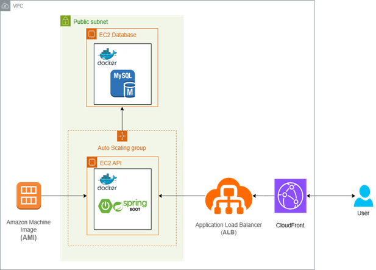

📷 **Frontend Screenshots**

  
  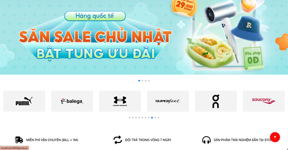
  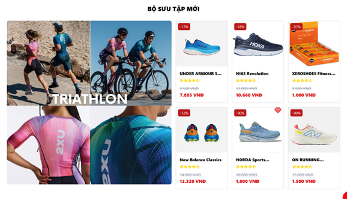
  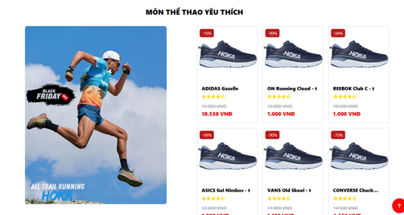
  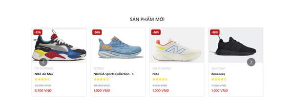
  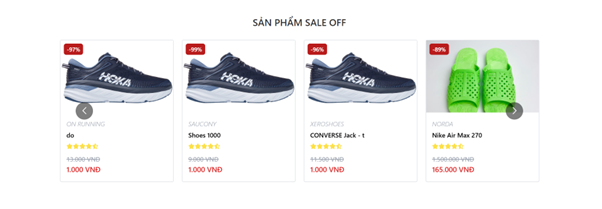
  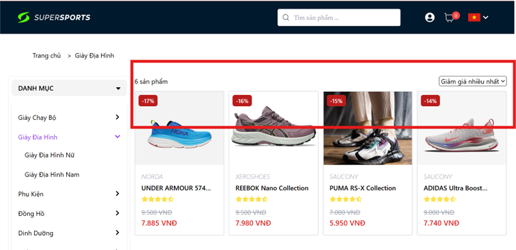
  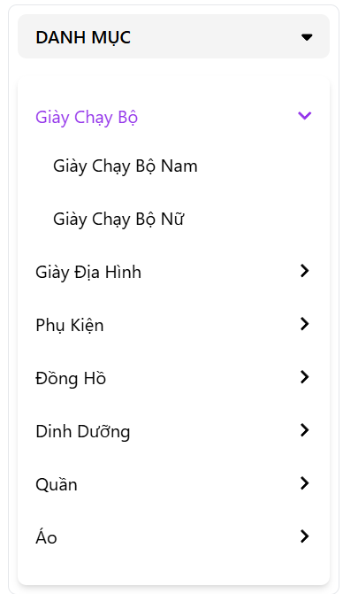
  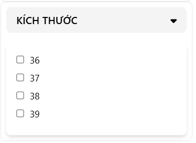
  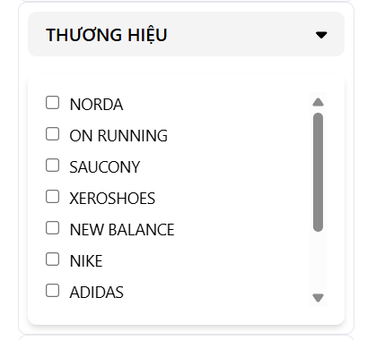
  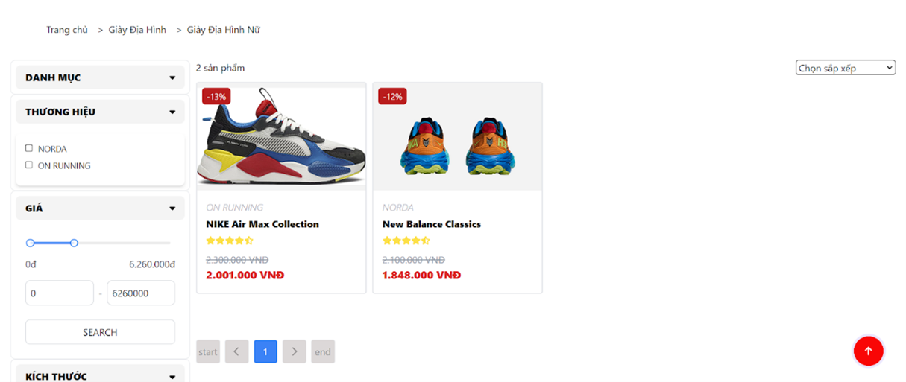
  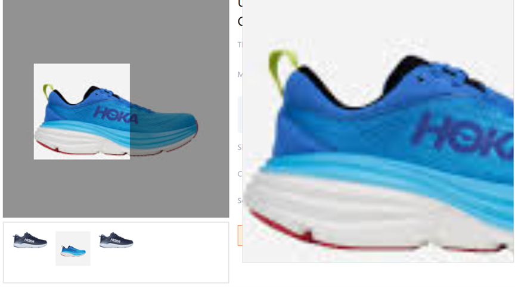
  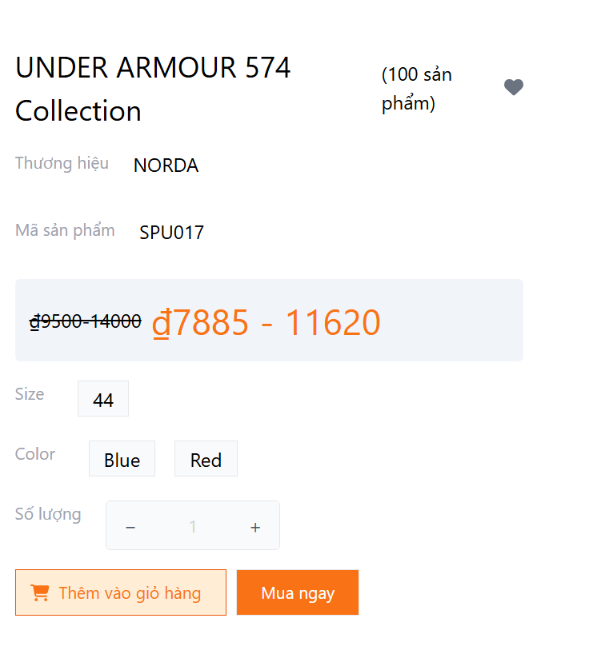
  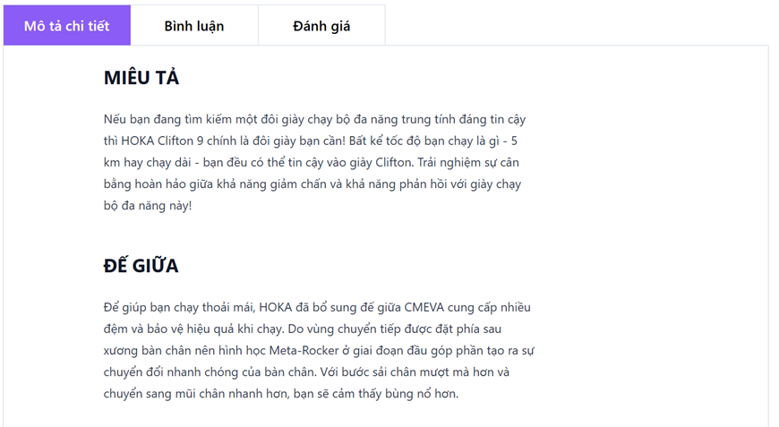
  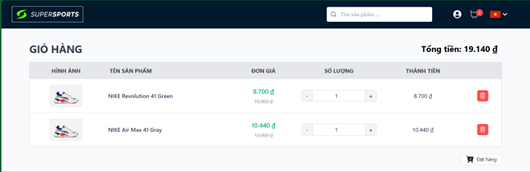
  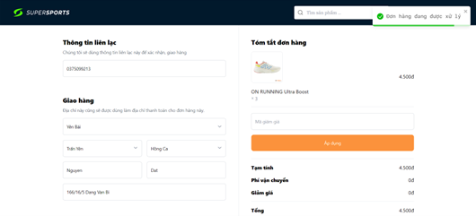

